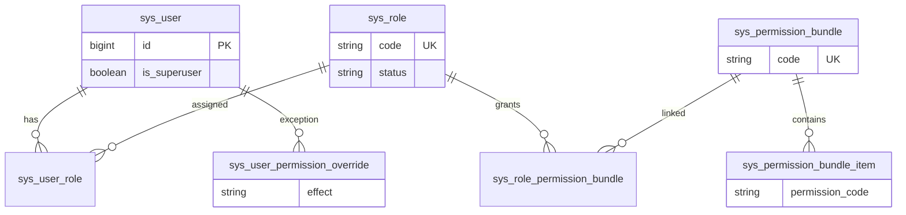
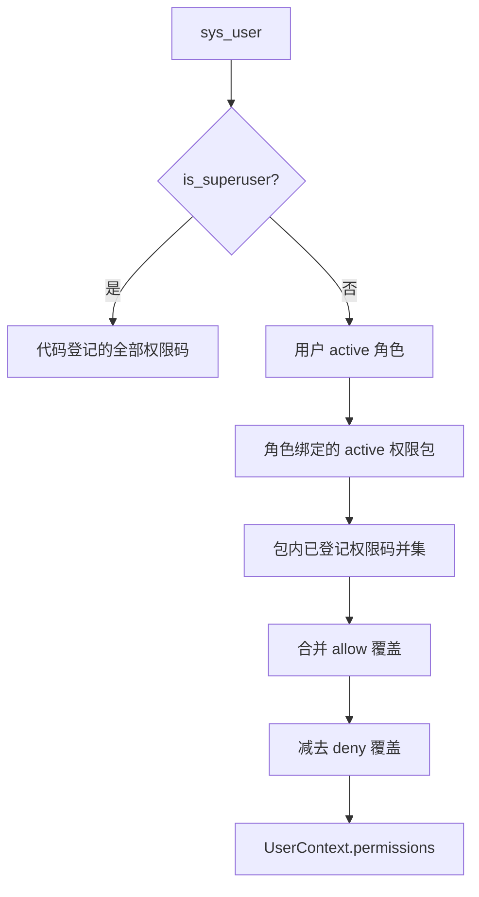
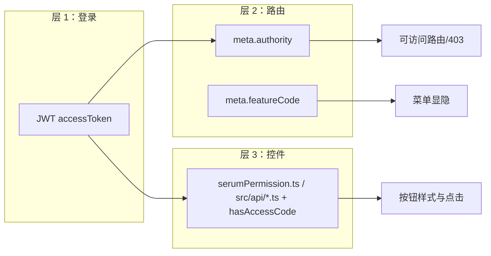
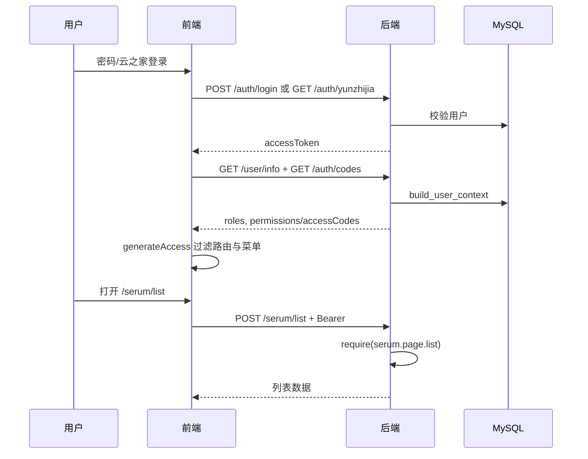

# 认证与权限

本文说明 Antibody Forge 的**完整权限逻辑**：数据模型、生效规则、前后端分工，以及血清业务的**项目负责人**二次校验。

## 1. 模型总览

权限采用 **RBAC + 权限包 + 个人覆盖**，与 `sys_user` 上的部门/组别等组织字段**解耦**。



| 表 | 作用 |
|----|------|
| `sys_user` | 账号；`is_superuser`  bypass 常规权限汇总 |
| `sys_role` | 角色（示例：`guest`、`operator`、`system_admin`；生产可完全自定义） |
| `sys_permission_bundle` | 权限包，便于按岗位批量授权 |
| `sys_permission_bundle_item` | 包 ↔ 权限码多对多 |
| `sys_user_role` | 用户 ↔ 角色 |
| `sys_role_permission_bundle` | 角色 ↔ 权限包 |
| `sys_user_permission_override` | 个人例外：`allow` / `deny` |
| `sys_feature_flag` | 菜单/功能/任务开关的管理员覆盖值（**非** RBAC，见 §7） |
| `sys_operation_log` | 操作日志摘要 |
| `sys_operation_log_item` | 操作日志实体/字段明细 |

**权限点不在库里**：每个模块在自己的 `permissions.py` 用 `page()` / `action()` / `data()` 声明权限点（名称、类型、资源、403 文案），`modules/registry.py` 汇总成 `PERMISSIONS`；权限管理页、有效权限、操作日志动作名都读它。授权表里代码已不登记的权限码运行时忽略。

DDL 与示例权限包、角色见 [vita-database.sql](./vita-database.sql)。

## 2. 权限点编码约定

格式：`<模块>.<资源类别>.<动作>`，例如 `serum.project.edit`。

| `type` | 含义 | 典型用途 |
|--------|------|----------|
| `page` | 页面级 | 控制路由 `meta.authority`、能否进入某页 |
| `action` | 操作级 | 控制按钮显隐；后端写接口及少量读接口用 `require(...)` 检查 |
| `data` | 数据范围 | 不放行接口，由模块按它收窄能看、能改的数据（能不能改仍看 `action` 权限），如文库构建按建库类型限定（见 [library-construction.md](./modules/molecular-cell/library-construction.md) §1） |

### 2.1 血清模块（`serum.*`）

| 权限码 | 类型 | 说明 |
|--------|------|------|
| `serum.page.workbench` | page | 免疫工作台（查看） |
| `serum.workbench.edit` | action | 免疫工作台全部编辑，供管理员使用 |
| `serum.workbench.draft_edit` | action | 新建、复制及维护草稿；只能编辑/删除“草稿”，不能改状态、审核结果、是否可开展、审核人，不能开展或下架 |
| `serum.workbench.support_edit` | action | 只编辑“小鼠后勤”和“抗原”字段，并可填写抗原活性验证；不能新增、复制、删除、开展、下架或修改其他分区 |
| `serum.page.list` | page | 免疫实验列表 |
| `serum.page.detail` | page | 详情页 |
| `serum.page.edit` | page | 编辑页 |
| `serum.page.titer` | page | 效价数据页 |
| `serum.page.titer_order` | page | 效价实验列表 |
| `serum.page.cell` | page | 细胞及库存页 |
| `serum.project.create` | action | 新建项目 |
| `serum.project.edit` | action | 编辑**本人负责**项目 |
| `serum.project.edit_all` | action | 编辑**任意**项目（含改负责人） |
| `serum.project.delete` | action | 删除项目 |
| `serum.status.update` | action | 快速改状态（§4.2） |
| `serum.status.auto_update` | action | 批量自动更新状态 |
| `serum.mouse.export` | action | 导出小鼠免疫数据 |
| `serum.cage.update` | action | 更新笼位 |
| `serum.titer.edit` | action | 编辑效价（免疫负责人、效价负责人，或 `edit_all`） |
| `serum.titer.edit_all` | action | 编辑任意项目效价 |
| `serum.file.manage` | action | 效价附件增删改 |
| `serum.cell.view` | action | 细胞库存数据（进页面还需 `serum.page.cell`） |
| `serum.cell.prep_status.update` | action | 更新任意项目制备状态（细胞库存页） |
| `serum.titer_order.edit` | action | 新建/编辑效价工单（含批次信息：笼位、采血、只数、检测方法等） |
| `serum.titer_order.delete` | action | 删除效价工单 |
| `serum.titer_order.owner.edit` | action | 编辑效价负责人列 |
| `serum.titer_order.record.edit` | action | 编辑检测日期、备注、效价小结、实验记录本（需为效价或免疫负责人，或 `record.edit_all`）；血清状态、检测优先级仅需本权限 |
| `serum.titer_order.record.edit_all` | action | 编辑任意工单检测记录字段（含效价小结） |

### 2.2 镁伽模块（`mega.*`）

| 权限码 | 类型 | 说明 |
|--------|------|------|
| `mega.page.flow_work_order` | page | 流式工单总览与详情 |
| `mega.flow_work_order.edit` | action | 保存、校验、删除、作废工单 |
| `mega.flow_work_order.dispatch` | action | 发送、撤回/停止/继续、确认执行、完成/失败及设备暂停确认等调度操作 |

**Labillion 回调** `POST /api/mega-automation/labillion/callback` **无需登录**（镁伽服务器推送）；路由不挂权限依赖，进入业务处理后恒返回 HTTP 200。来源校验可选：配置 `LABILLION_CALLBACK_TOKEN`（请求头 `X-Callback-Token`）或 `LABILLION_CALLBACK_IPS` 后，不满足的请求返回 401 / 403，不进业务处理；设备回传 `POST /api/order-experiment/sync` 同理，对应 `ORDER_SYNC_TOKEN` / `ORDER_SYNC_IPS`。实现见 `modules/auth/external.py`，配置说明见 [deploy.md](./deploy.md)。

**主动状态同步** `POST .../sync-labillion-status` 使用 `mega.page.flow_work_order`（与详情只读同级），供详情页进入时拉取镁伽最新状态；不登记人员权限动作映射，审计操作名为「同步镁伽状态」，实际数据变化仍由通用审计自动记录。

**手动执行定时任务** `POST /api/system/features/jobs/run` 需 `system.feature.manage`；body `{ "job_code": "job.xxx" }`。后台线程执行，结果记入 `sys_job_run_log` 与操作日志。

镁伽接口**无**项目负责人式行级归属，仅按上述权限点鉴权。

### 2.3 千鼠万抗（`atlas.*`）

| 权限码 | 类型 | 说明 |
|--------|------|------|
| `atlas.page.target_library` | page | 靶点库列表与详情浏览 |

靶点库为只读模块；列表与详情接口均使用该页面权限，没有写接口和操作日志。

### 2.4 抗体发现（`discovery.*`）

| 权限码 | 类型 | 说明 |
|--------|------|------|
| `discovery.page.workbench` | page | 发现工作台列表 |
| `discovery.workbench.edit` | action | 发现工作台全部编辑：新增、保存、删除、排序安排，可交接文库 |
| `discovery.workbench.immune_edit` | action | 发现工作台免疫编辑：可新增、保存其他字段（含血清效价）、删除、冻存和既往筛选，可从效价下发。不能改状态、优先级、负责人、排序、筛选抗原、阳性细胞数、板号，不能排序，不能交接文库 |
| `discovery.page.ngs` | page | NGS测序列表 |
| `discovery.ngs.edit` | action | NGS测序编辑：新建、保存、删除、送合成；也可从文库构建交接 |
| `discovery.page.synthesis_progress` | page | 合成与验证列表与外部订单比对 |
| `discovery.synthesis_progress.edit` | action | 合成与验证全部编辑：新增、保存、批量粘贴、把负责人标记为「无人问津」（或取消标记）、删除、采用来源变更及手动同步合成订单；只有此权限能看到全部合成公司（其他人看到 `***`，改造实验员只能看到改造类工单的） |
| `discovery.synthesis_progress.pm_edit` | action | PM操作合成与验证：新建工单（PM 自动填本人且不可改，负责人不可填）、认领「无人问津」合成结果（不限工单归属），认领 7 天内可改回「无人问津」，不能改给他人；仅限归属本人的工单（有负责人时只归负责人，负责人为空或「无人问津」时归 PM）可编辑项目与改造需求字段（项目编号、课题类型、靶点、小鼠品系、优先级、排序、订单性质、供应方式、改造类型/方式/母本/要求、备注）、调整排序及删除待下单工单；不能改 PM、实验号、靶点类型 |
| `discovery.synthesis_progress.eng_edit` | action | 改造实验员操作合成与验证：只管改造、内部转染、改亚型的工单。可新建这类工单（下单人填本人，PM 默认本人可改，负责人不可填），可修改其中除负责人、靶点底色、亲和力与流式外的全部字段（含状态、合成订单与到货信息、合成公司），可调整排序、删除未关联 One 的工单；能看到这类工单的合成公司。不能认领 |
| `discovery.synthesis_progress.affinity_edit` | action | 亲和力操作合成与验证：在状态列往返修改亲和力实验状态（待检测/检测中/已完成），并编辑亲和力人员、亲和力结果、亲和力日期、未出原因（填亲和力日期时亲和力人员为空会自动填本人）；不能打回已完成的工单 |
| `discovery.synthesis_progress.flow_edit` | action | 流式操作合成与验证：在状态列往返修改流式实验状态（待检测/已完成/不做），并编辑流式日期、流式说明；不能打回已完成的工单。与亲和力权限同时具备时，可在有未出原因时把亲和力标为已完成（结案），也可把已完成的工单打回待检测重做，或把任何未取消的工单改为已取消（不能从已取消改回） |

写接口 `POST /api/discovery/workbench/save`、`/save_batch`、`/delete`、`/reorder`，`/api/discovery/ngs/save`、`/batch_save`、`/delete`、`/handoff_library`、`/handoff_synthesis`，以及 `/api/discovery/synthesis-progress/save`、`/save_batch`、`/claim`、`/reorder`、`/delete`、`/adopt_source`、`/sync_now` 在路由上用 `require(..., audit=)` 声明操作日志名称。字段与规则见 [modules/discovery/workbench.md](./modules/discovery/workbench.md)、[modules/discovery/ngs.md](./modules/discovery/ngs.md) 与 [modules/discovery/synthesis-progress.md](./modules/discovery/synthesis-progress.md)。权限码和菜单开关（`menu.discovery` / `menu.discovery.workbench` / `menu.discovery.ngs` / `menu.discovery.synthesis_progress`）在 `modules/discovery/permissions.py`。不写入示例角色/权限包；超级管理员走 `is_superuser`，其他人在系统管理里按需授权。选靶点 / 人名时复用公共选项接口 `GET /api/options/targets` 与 `/api/options/users`：能打开任一业务页面（系统管理以外的 page 类权限）即可访问，新模块的页面权限自动包含在内。

### 2.5 分子与细胞（`molecular.*`）

| 权限码 | 类型 | 说明 |
|--------|------|------|
| `molecular.page.library` | page | 文库构建列表与字典查询 |
| `molecular.library.edit` | action | 两页的工单编辑：保存、取消、Excel、手工新增、删除；申请冻存细胞出库 |
| `molecular.library.cell_checkout.review` | action | 审核文库构建提交的冻存细胞出库申请（通过即写出库） |
| `molecular.library.type.plate_single_cell` | data | 限定单细胞孔板：配了其中几种的人只能看、改这些类型（改仍需编辑或质检权限），一个都没配的不限；七种都配上则一张工单都看不到，页面仍可进，出库审核不收窄 |
| `molecular.library.type.pooled_bcr` | data | 限定混管 H/K/L：规则同上，多个类型权限点一起配时范围取并集 |
| `molecular.library.type.pooled_barcode` | data | 限定混管 Barcode：规则同上 |
| `molecular.library.type.peripheral_blood_bcr` | data | 限定外周血 BCR：规则同上 |
| `molecular.library.type.plasma_ngs` | data | 限定浆细胞 NGS：规则同上 |
| `molecular.library.type.phage_display` | data | 限定噬菌体展示：规则同上 |
| `molecular.library.type.phage_ngs` | data | 限定噬菌体 NGS：规则同上 |
| `molecular.page.library_detail` | page | 质控详情、文件列表与下载 |
| `molecular.library.file.manage` | action | 质检文件，以及质检结论、质检人、质检日期、质检说明 |
| `molecular.page.primer` | page | 引物库 |
| `molecular.primer.edit` | action | 新增、修改、停用、删除、改系列、改方向和批量导入引物 |
| `molecular.page.transfection` | page | 转染与表达和转染表查询 |
| `molecular.transfection.edit` | action | 转染工单新建、编辑、删除，导入和删除蛋白清单，交接到合成与验证，在文库构建交接单细胞孔板 |

写接口 `POST /api/molecular-cell/library-orders/save`、`/batch_save`、`/delete`、`/handoff`、`/cell_checkout/submit`、`/cell_checkout/review`、`/files/upload_batch`、`/files/update`、`/files/delete`、`/catalog/save`、`/catalog/delete`、`/catalog/batch_update`、`/catalog/batch_delete`、`/catalog/batch_save` 在路由上声明操作日志名称；使用 POST 返回文件的 `/catalog/export` 按页面权限检查，和其他导出一样不记日志。上传前的路径预检 `/files/preflight` 和出库候选查询 `/cell_checkout/candidates` 不写库，用 `audit_quiet()` 不记日志。查询 `/catalog/list`、`/catalog/column_values` 和全选 `/catalog/ids` 不记操作日志。取消统一通过 `/save` 更新状态。只改质检结论、质检人、质检日期、质检说明时，`/save` 也接受 `molecular.library.file.manage`；`/batch_save` 在每一条都只改这些字段时同样接受。`POST /handoff` 与 `GET /by-discovery` 同时接受 `discovery.workbench.edit`。字段、类型 profile 与交接规则见 [modules/molecular-cell/library-construction.md](./modules/molecular-cell/library-construction.md)。转染与表达的写接口 `POST /api/molecular-cell/transfection/save`、`/batch_save`、`/delete`、`/handoff_library`、`/handoff_synthesis`、`/proteins/import`、`/proteins/clear` 声明操作日志名称；`/handoff_library` 同时接受 `molecular.library.edit`，并按文库构建的建库类型范围收窄；查询与导出不记日志，见 [modules/molecular-cell/transfection.md](./modules/molecular-cell/transfection.md)。权限码和菜单开关（`menu.molecular_cell` / `menu.molecular_cell.library` / `menu.molecular_cell.primer` / `menu.molecular_cell.transfection`）在 `modules/molecular_cell/permissions.py`。不写入示例角色/权限包。已录入靶点搜索用本模块的 `GET /api/molecular-cell/library-orders/recorded_targets`；选靶点 / 人名用公共选项接口 `GET /api/options/targets` 与 `/api/options/users`。

### 2.6 系统模块（`system.*`）

| 权限码 | 类型 | 说明 |
|--------|------|------|
| `system.page.user` | page | 用户管理页 |
| `system.page.role` | page | 角色管理页 |
| `system.page.permission` | page | 权限管理页 |
| `system.page.operation_log` | page | 操作日志页 |
| `system.page.feature` | page | 系统功能页 |
| `system.user.manage` | action | 用户增删改、重置密码、批量角色 |
| `system.role.manage` | action | 角色 CRUD |
| `system.permission.manage` | action | 权限包、权限点、个人覆盖 |
| `system.operation_log.view` | action | 查看操作日志 |
| `system.feature.manage` | action | 修改功能开关、定时任务配置；手动执行定时任务（查看用 `page.feature`） |

**page 与 action**：`page.*` 管进路由；各 Tab 及其读写接口靠对应的 `manage` / `view` action。

### 2.7 权限包与角色（示例种子）

`docs/vita-database.sql` 文末的权限包 / 角色仅为空库示例；新增页面只加权限点，不要改现网角色/权限包。

新模块可先设置一个路由查看权限和一个全部编辑权限；二者长期保留，需要时再按操作拆分更细权限。

示例三档（角色 code 与权限包 code 相同，1:1 绑定）：

| 角色 / 包 code | 名称 | 大致范围 |
|----------------|------|----------|
| `guest` | 访客 | 血清 / 镁伽普通页面只读及 `serum.cell.view`；另含用户、角色、权限、系统功能四个 `system.page.*`，因没有对应 action，只能只读查看系统功能页；不含操作日志权限 |
| `operator` | 业务员 | 血清 + 镁伽日常编辑；工作台默认使用草稿编辑和实验保障权限，无工作台全部编辑、`edit_all`、`auto_update`、删工单等管理权限 |
| `system_admin` | 系统管理 | `system.*` 全部 10 个权限点 |

**超级管理员**不走上表：`sys_user.is_superuser=TRUE` 即 bypass 全部权限，**无需**绑定角色或权限包（见 `vita-database.sql` 文末注释）。超级管理员账号的编辑资料、重置密码、删除，以及任何人的超级管理员开关，只有超级管理员能操作（其他人返回 403，页面上也不显示这两个按钮），免得有「管理用户」权限的人借此拿到全部权限。

实际授权流程：**给用户分配角色** → 角色绑权限包 → 展开为权限点；另可对单用户设置 `allow` / `deny` 覆盖。

## 3. 后端：权限如何计算

实现：`bbctg_vita_server/modules/auth/permissions.py`。



规则摘要：

1. **超级管理员**（`is_superuser=true`）：拥有代码登记的全部权限码。**不依赖**角色与权限包。
2. **普通用户**：`角色 → 权限包 → 权限码` 去重；只统计 `status=active` 的角色和包，代码已不登记的权限码忽略。
3. **个人覆盖**：`allow` 并入集合，`deny` 从集合移除（deny 优先）。
4. **组织字段**（部门、组别、职位等）不参与上述计算。

校验 API：

```python
@router.post("/save", dependencies=[require("x.edit", audit="保存某某")])  # 路由声明：有任一权限码即放行，否则 403
context: UserContext = Depends(get_user_context)                         # 按数据判断时在函数体里用
context.allows("a", "b")   # 判断
context.require("a")       # 无权限则 HTTP 403
```

同一请求里路由的 `require` 和函数体共用一次权限计算（`get_user_context` 是请求级依赖）。登录后上下文通过 `build_user_context` 生成，并在 `/api/user/info`、`/api/auth/codes` 下发给前端（`permissions` 与 `accessCodes` 内容相同）。`/api/user/info` 的 `avatar` 按 `sys_user.avatar` 解析：未设置时按用户 ID 和当天日期从站内 `/avatars/avatar-01.gif` 到 `avatar-15.gif` 随机一张，当天刷新不变；`text` 返回空串，前端显示姓名文字（不参与随机）；其余为用户选的站内动图、上传图片或外部链接。`avatarSetting` 是原始设置，`builtinAvatars` 是站内动图列表，个人中心点头像可更换。

## 4. 后端：接口鉴权与业务规则

### 4.1 认证入口

| 方式 | 路由 | 说明 |
|------|------|------|
| 账号密码 | `POST /api/auth/login` | 校验 `password_hash`，写登录日志 |
| 云之家 | `GET /api/auth/yunzhijia?ticket=` | `openid` 绑定 `sys_user`；未绑定且未开启 `feature.yunzhijia_auto_provision` 则 403 |
| 当前用户 | `Depends(get_current_user)` | 解析 JWT `sub` → 用户 id，`status=active` |

JWT 由 `SECRET_KEY` 签名；所有业务路由默认需携带 `Authorization: Bearer <token>`。

**无需权限点**的接口（仍需登录）：

- `PUT /api/auth/user/profile` — 个性名片
- `PUT /api/auth/user/avatar` — 本人头像设置（`avatar` 传空串、`text`、站内动图地址、本人上传地址或 http(s) 链接）
- `POST /api/auth/user/avatar/upload` — 上传本人头像图片或动图（≤5MB），存 `uploads/avatars/`，换头像时删掉旧上传文件
- `POST /api/auth/user/change_password` — 设置/修改本人密码（≥6 位，不需原密码）

`GET /api/auth/avatar/{文件名}` 不需登录，供 `` 直接加载上传的头像；文件名带用户 ID 和随机串。

### 4.2 血清：权限 + 项目负责人

部分接口在权限检查之后还有**数据归属**判断（`serum/routes.py`、`titer/routes.py`）：

| 场景 | 规则 |
|------|------|
| 免疫工作台查看 | `serum.page.workbench` |
| 免疫工作台全部编辑 | `serum.workbench.edit`（无项目负责人二次校验） |
| 工作台草稿维护 | `serum.workbench.draft_edit`；按草稿状态和字段白名单校验，可保存草稿方案 |
| 工作台实验保障 | `serum.workbench.support_edit`；按“小鼠后勤”和“抗原”字段白名单校验，不限制项目状态 |
| 抗原活性验证 | 查看：`serum.page.workbench` 或 `serum.page.detail`；填写判定、上传/删除图片：`serum.workbench.edit` 或 `serum.workbench.support_edit`，不看项目负责人和状态 |
| 工作台开展 | `serum.workbench.edit`，外加 `serum.project.edit` 或 `serum.project.edit_all`（此时尚无正式项目，不校验负责人） |
| 靶点搜索 | `serum.page.edit` 或 `serum.page.workbench` |
| 保存项目（有 id） | 当前负责人或审核人且不改负责人 → `serum.project.edit`；否则 `serum.project.edit_all` |
| 新建项目 | `serum.project.create`；无 `edit_all` 时只能把自己设为 `owner` |
| 改实验记录本 / 审核人 | 与方案编辑相同：`serum.project.edit_all`，或 `serum.project.edit` 且为项目负责人或审核人 |
| 改笼位 | `serum.cage.update` + 项目负责人或 `edit_all` |
| 改状态 | 项目负责人：`status.update` 或 `titer.edit`；非负责人：`status.update`+`edit_all`，或 `titer.edit`+`titer.edit_all` |
| 鼠号分组查询 / 鼠号明细保存 | `serum.project.edit` / `edit_all` / `serum.titer.edit` / `titer.edit_all` **任一**；有意不校验项目负责人，因为效价工单的选鼠向导（`TiterMouseSelectWizard`）也给效价负责人用 |
| 导出免疫方案（Excel/PDF） | `serum.page.detail` |
| 细胞库存 | `serum.cell.view`（页面还需 `page.cell`） |
| 改制备状态 | `serum.cell.prep_status.update` |
| 效价只读 | `serum.page.detail` 或 `serum.page.titer` |
| 效价写 | 对应 action + 项目负责人、效价负责人或 `titer.edit_all` |
| 效价工单（批次/删除/负责人） | 对应 `titer_order.*` action，无归属校验 |
| 效价工单（检测记录） | 检测日期 / 备注 / 小结：`record.edit` + 负责人或 `record.edit_all`；血清状态 / 检测优先级：仅 `record.edit` |
| 自动更新状态 | `serum.status.auto_update` |

负责人匹配：用户 `username` / `display_name`（前端下发为 `realName`）与项目 `owner` 字符串比对（含姓名首段别名）。项目审核人 `reviewer` 与项目负责人同权：上表“项目负责人”“免疫负责人”均包含审核人，但审核人不能改负责人。

> **安全边界**：前端按钮隐藏不能代替后端校验；所有写接口以路由的 `require(...)`、函数体里的 `context.require(...)` 及上述归属逻辑为准。

### 4.3 镁伽：仅权限点鉴权

流式工单读写与调度（`mega_automation/routes.py`）分别校验 `mega.page.flow_work_order`、`mega.flow_work_order.edit`、`mega.flow_work_order.dispatch`，无额外数据归属判断。

## 5. 前端：三层控制



### 5.1 路由与菜单（层 2）

- **访问模式**：`accessMode: 'frontend'`（`bbctg_vita_web` 默认配置）。
- 登录后拉取用户信息与权限码，用**角色 + 权限码**匹配 `meta.authority` 过滤路由。
- 路由 `meta.authority` 声明进入页面所需的**任一**权限码（OR 关系）。
- `meta.featureCode` 对应 `sys_feature_flag`：控制菜单是否显示、排序；与 RBAC 正交。拉取失败时隐藏受控菜单项。
- 父级路由需配置 `authority`（如 `/system`），否则子路由全被过滤后仍可能出现空目录。

路由定义位置：`bbctg_vita_web/apps/antibody_vita/src/router/routes/modules/*.ts`。下文前端路径均相对 `bbctg_vita_web/apps/antibody_vita/src/`。

### 5.2 按钮与交互（层 3）

血清页使用 `utils/serumPermission.ts`，大体与 §4.2 对齐，例如：

- `canAccessWorkbench` → `serum.page.workbench`
- `canEditWorkbench` → `serum.workbench.edit`
- `canEditWorkbenchDraft` → `serum.workbench.draft_edit`
- `canEditWorkbenchSupport` → `serum.workbench.support_edit`
- 工作台开展按钮 → `canEditWorkbench` 且 `hasSerumProjectEditPermission`（`project.edit` 或 `edit_all`）
- `canEditSerumProject` → `edit_all` 或（`project.edit` 且 owner）
- `canUpdateSerumStatus` → `status.update` 且（owner 或 `edit_all`）；**比后端略严**（后端负责人还可凭 `titer.edit` 改状态，见 §4.2）
- `canEditSerumTiter` → `titer.edit` 且（owner、效价负责人或 `titer.edit_all`）

各业务模块的权限码常量放在对应的 `src/api/*.ts`。例如镁伽流式工单常量位于 `api/megaAutomation.ts`，页面通过 `hasAccessCode` 判断 `FLOW_WORK_ORDER_EDIT` 与 `FLOW_WORK_ORDER_DISPATCH`。`utils/serumPermission.ts` 只保留血清模块需要结合项目负责人等数据判断的业务规则。

系统管理页各 Tab 按 `system.*.manage` / `operation_log.view` 显隐。权限点列表、权限包里的权限点、个人覆盖都按模块收起，展开后按页面列出，可按名称或权限码搜索。

无权限时多为 `no-permission-btn` 样式，而非路由级 403。

### 5.3 个人中心

`/profile` 无 `authority`，凡已登录用户可访问。

### 5.4 系统首页（门户）

- **`/home`** 为系统级默认落地页（`defaultHomePath`、`build_user_info` 的 `homePath`）；**不设 `meta.authority`**，凡已登录用户可访问（含零角色账号）。
- 用户可在首页快捷导航里把某个入口设为登录后默认页（`HOME_START_PAGE_STORAGE_KEY`）。该偏好只存浏览器 `localStorage`，不落库；未设置时用服务端 `homePath`。
- 首页的公告、便签等为前端静态数据或 `localStorage`（`views/Home/home-data.ts`）；天气走 `GET /api/home/weather`（登录即可读取），由后端 `integrations/weather.py` 先查 Open-Meteo、失败再查 weather-api.site，结果全站共用 30 分钟；天气图标随前端打包（`views/Home/assets/meteocons`），浏览器不访问外网。

路由与页面：`router/routes/modules/home.ts`、`views/Home/`。

## 6. 操作审计

主库 ORM 写入会自动记操作日志；新模块一般不必写审计代码。系统管理页看摘要与字段明细。

- **谁在记**：HTTP 写请求由审计中间件带上用户、路径和权限动作名；实体变化由 `AuditedSession` 在事务提交时写入。
- **记什么**：`sys_operation_log` 一条请求/事务的摘要；`sys_operation_log_item` 每个实体的变更。编辑展开 JSON 到变化路径；新建和删除只记表字段快照，大 JSON 记规模不展开孔位。
- **何时显式调用**：登录、设备回调等没有实体变化的事件用 `write_operation_log()`；与 ORM 变化同事务时会合并明细。
- **不记**：`GET`、标准只读后缀和用 `audit_quiet(...)` 声明的查询/导出型 `POST`。声明了操作名的写接口若成功但没有字段变化，仍记一条操作头（无明细，变更列显示 `-`）。密码、token、secret、cookie、私钥等只记“已变化”。
- **事务**：SAVEPOINT 归入根事务；只有根事务提交成功才算日志已持久化。
- **容量**：单事务最多 200 个实体、每实体 500 处变化；超限截断详情，不限制日志表总量。启动时校验审计表字段并缓存数据库注释。

操作名和资源分类由各模块的 `routes.py` 在路由依赖中声明；`modules/system/audit_routes.py` 提供 `audit`、`audit_quiet`、`permission_action` 与 `route_audit`。每个写接口必须有一种声明，标准只读后缀（`/list`、`/column_values`、`/export_list`、`/export`、`/stats`）除外：

- `require(code, audit="操作名")`：权限检查和操作名一起声明，操作类型、资源取自权限点；
- `audit(...)`：权限要按数据在函数体里判断，或不走权限点（登录、设备回调）时单独声明；
- `audit_quiet(...)`：查询、核对类 `POST`，没有数据变化不记日志。

`main.py` 通过 `FastAPI(dependencies=[Depends(bind_route_audit)])` 注册全局依赖；`audit_middleware.py` 中的 `bind_route_audit` 在路由匹配后绑定该路由的审计声明。同一路由可以声明多个权限动作，并在运行时调用 `audit_context.py` 的 `use_audit_action(code)` 缩小到实际动作；文库工单保存接口据此把只修改质检结论的请求记为 `molecular.library.file.manage`。

同一路由若同时挂 create/edit，以是否插入了对应主资源为准，避免已有项目加子记录被标成新建。`main.py` 启动时用 `api_routes()` 检查未分类写路由并记录警告；测试通过 `modules/system/audit_coverage.py` 与 `api_routes()` 检查每个写路由都有声明，并核对登记路径与实际服务路径一致。

## 7. 功能开关（`sys_feature_flag`）

与 RBAC 分离，用于运行时配置（菜单显隐、部分业务能力、定时任务开关）。编码、名称、分类、默认值和默认排序由各模块 `permissions.py` 的 `menu()` / `feature()` / `job()` 登记；库里只存管理员改过的启用、显示、排序和配置（排序为空时用登记值），没登记的编码忽略。读写逻辑见 `modules/system/features.py`。

| category | code | 作用 |
|----------|------|------|
| `menu` | `menu.atlas`、`menu.atlas.target_library` | 千鼠万抗侧栏 |
| `menu` | `menu.serum`、`menu.serum.workbench`、`menu.serum.list`、`menu.serum.titer_order` | 免疫实验侧栏 |
| `menu` | `menu.discovery`、`menu.discovery.workbench`、`menu.discovery.ngs`、`menu.discovery.synthesis_progress` | 抗体发现侧栏 |
| `menu` | `menu.molecular_cell`、`menu.molecular_cell.library`、`menu.molecular_cell.primer` | 分子与细胞侧栏 |
| `menu` | `menu.mega_automation`、`menu.mega_automation.flow_work_orders` | 镁伽自动化侧栏 |
| `menu` | `menu.system`、`menu.system.user_permission`、`menu.system.features` | 系统管理侧栏 |
| `feature` | `feature.drm_file_security` | DRM 上传解密 / 下载加密（请求时读库，立即生效；另需 env 与 SDK） |
| `feature` | `feature.yunzhijia_auto_provision` | 云之家登录自动开户（请求时读库，立即生效） |
| `job` | `job.employee_profile_sync`、`job.target_master_sync`、`job.serum_auto_update_status`、`job.discovery_auto_update_status`、`job.mega_labillion_status_sync`、`job.discovery_synthesis_order_sync`、`job.discovery_supernatant_pull` | 定时任务开关与执行时间；各任务作用与默认时间见 [deploy.md](./deploy.md)「定时任务」 |

**定时任务页（系统功能）**：启用开关与执行时间改完即写库，并立即重排正在运行的调度，无需重启。「立即执行」随时可点，直接调对应 job 函数，local 未开 scheduler 也可用。

有效配置接口：`GET /api/system/features/effective`（前端 `getSystemEffectiveFeaturesApi`），登录即可读，只返回菜单与功能开关（不含定时任务和 cron 细节）。系统状态 `GET /api/system/features/system_status`（服务器时间、环境、调度是否在跑）需要 `system.page.feature`。定时任务执行前取 MySQL `GET_LOCK`，多进程同时触发时只有一个真正执行，其余只在应用日志里记一条跳过。

## 8. 端到端流程（登录后访问血清列表）



## 9. 初始化

1. 执行 [vita-database.sql](./vita-database.sql)（含示例权限包和角色；权限点、功能开关默认值在代码里，不用插入）。
2. 按文件文末注释创建首个超管：`is_superuser=TRUE`，**不绑角色**；在 `bbctg_vita_server` 目录生成 `password_hash` 后执行 `INSERT`。
3. 云之家用户绑定 `openid`，或在系统功能中开启「云之家自动创建用户」允许自动开户。
4. 部署与验收见 [deploy.md](./deploy.md)。

## 10. 代码索引

|  Concern | 路径 |
|----------|------|
| 权限点与功能开关登记 | `bbctg_vita_server/modules/<模块>/permissions.py`，汇总在 `modules/registry.py` |
| 有效权限与路由权限声明 | `bbctg_vita_server/modules/auth/permissions.py` |
| 写接口审计声明 | 各模块 `routes.py`；声明工具与解析在 `bbctg_vita_server/modules/system/audit_routes.py` |
| 写操作审计 | `bbctg_vita_server/modules/system/audit.py`（入口）、`audit_session.py`、`audit_middleware.py`、`audit_config.py` |
| 功能开关 | `bbctg_vita_server/modules/system/features.py` |
| 系统管理 API | `bbctg_vita_server/modules/system/routes.py` |
| 血清 API | `bbctg_vita_server/modules/immunology/serum/routes.py` |
| 效价 API | `bbctg_vita_server/modules/immunology/titer/routes.py` |
| 细胞库存 API | `bbctg_vita_server/modules/immunology/cell/routes.py` |
| 抗体发现 API | `bbctg_vita_server/modules/discovery/workbench/routes.py` |
| 文库构建 API | `bbctg_vita_server/modules/molecular_cell/library_orders/routes.py` |
| 引物库 API | `bbctg_vita_server/modules/molecular_cell/primer_catalog/routes.py` |
| 转染与表达 API | `bbctg_vita_server/modules/molecular_cell/transfection/routes.py` |
| 镁伽 API | `bbctg_vita_server/modules/mega_automation/routes.py` |
| 认证 | `bbctg_vita_server/modules/auth/` |
| 路由守卫 | `bbctg_vita_web/apps/antibody_vita/src/router/guard.ts` |
| 系统首页 | `bbctg_vita_web/apps/antibody_vita/src/views/Home/` |
| 血清前端权限 | `bbctg_vita_web/apps/antibody_vita/src/utils/serumPermission.ts` |
| 前端权限码常量 | `bbctg_vita_web/apps/antibody_vita/src/api/*.ts` |
| 前端通用权限判断 | `bbctg_vita_web/apps/antibody_vita/src/utils/accessCode.ts` |
| ORM 模型 | `bbctg_vita_server/models/system.py` |
