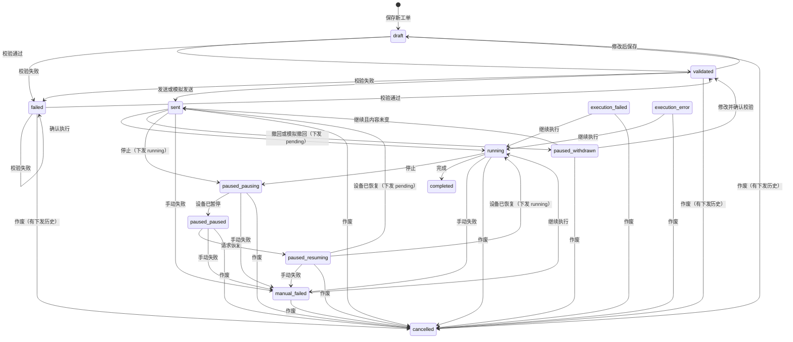

# 镁伽自动化 · 流式工单
> 维护流式工单、板布局、设备下发和 Labillion 状态。相关：[效价上游创建流程](./titer-upstream-flow.md) · [工单数据回传接口](./order-experiment-sync-api.md)

## 1. 入口与权限

| 项目 | 值 |
|---|---|
| 列表路由 | `/mega-automation/flow-work-orders` |
| 详情路由 | `/mega-automation/flow-work-orders/detail` |
| 一级菜单开关 | `menu.mega_automation` |
| 列表菜单开关 | `menu.mega_automation.flow_work_orders` |
| 页面权限 | `mega.page.flow_work_order` |
| 编辑权限 | `mega.flow_work_order.edit` |
| 下发权限 | `mega.flow_work_order.dispatch` |

页面权限控制列表、详情、元数据、筛选值、导出、当前 Payload 和状态同步。编辑权限控制保存、校验、删除和作废。下发权限控制发送及手动状态操作。

## 2. 数据与编号

### 2.1 工单

表：`mega_flow_work_order`。

| 字段 | 含义 | 规则 |
|---|---|---|
| `id` | 工单主键 | 系统生成 |
| `orderNum` | 订单编号 | 必填，允许重复 |
| `orderName` | 订单名称 | 可空 |
| `orderType` | 来源类型 | `TITER`、`PLAS`、`PCR` |
| `source_id` | 来源业务主键 | 可空；首次写入后不能改为其他值 |
| `priority` | 优先级 | `high`、`normal`、`low` |
| `status` | 工单状态 | 见 §3 |
| `content` | 工单内容 | 只存 `pc_infos`、`sample_plates`、`cell_plates` |
| `content_hash` | 内容版本 | 编辑已有工单时必须提交 `expected_content_hash` |
| `project_nos`、`targets` | 列表检索数组 | 保存时从样本板重新提取 |
| `sample_plate_barcodes`、`cell_plate_barcodes` | 列表检索数组 | 保存时从板数据重新提取 |
| `sent_at` | 发送时间 | 每次发送成功后更新 |

`content_hash` 覆盖订单名称、编号、类型、优先级、备注和完整 `content`。版本不一致时拒绝保存。已校验工单修改后回到 `draft`。

### 2.2 工单内容

| 结构 | 关键字段 | 规则 |
|---|---|---|
| `pc_infos[]` | `pc_id`、`pc_type`、`pc_name`、`catalog_batch`、`source`、`concentration` | `pc_type` 为 `SERUM`、`ISO`、`TAG`；临时 ID 保存时替换为稳定 ID |
| `sample_plates[]` | `barcode`、`project_no`、`target`、`target_codes`、`secondary_antibody`、`cell_keys`、`wells` | `cell_keys` 为 `{ barcode, column_no }[]` |
| `sample_plates[].wells[]` | `well_no`、`content_type`、`sample_code`、`pc_id` | 固定 A01-H12，共 96 孔 |
| `cell_plates[]` | `barcode`、`columns` | 每板固定 1-12 列 |
| `cell_plates[].columns[]` | `column_no`、`cell_name`、`cell_type`、`species`、`batch`、`generation`、`cell_count`、`catalog_no`、`source` | 有细胞名称时 `cell_type` 缺省为 `正常` |

孔位类型为 `SAMPLE`、`PC`、`NC`、`ISO`、`TAG`、`BLANK`。`PC`、`ISO`、`TAG` 可不关联 `pc_id`；有关联时必须分别指向 `SERUM`、`ISO`、`TAG` 类型。

二抗为空时，`TITER` 补为 `鼠`，其他类型补为 `人`。页面可选人、猴、鼠、狗；不是人或鼠时只警告，不阻止校验和发送。

### 2.3 校验

- 至少有一块样本板和一个已命名细胞列。
- 样本板条码非空且工单内不重复；只允许字母、数字、英文括号和中划线。
- 项目号和细胞板条码非空；只允许字母、数字、英文括号、下划线和中划线。
- 靶点非空。样本编码非空时使用与项目号相同的字符范围。
- 每块样本板必须完整包含 96 个不重复标准孔位；每块细胞板必须完整包含 1-12 列。
- 每块样本板至少选择一个有效细胞列，只能选择同一块细胞板，且选中列的细胞名称不能重复。
- 样本板条码与细胞板条码不能重复。
- `PCR` 的每个靶点至少有一块同靶点、条码以 `-PC` 结尾的样本板。
- 其他未作废工单已经选用的细胞列不能再次选用，也不能改写其细胞信息。保存、校验和发送都会复查占用。
- 保存会移除回车、制表符、控制字符和零宽字符。

校验失败写入 `failed` 和 `error_message`，接口同时返回带字段路径的 `issues`。

### 2.4 下发记录

表：`mega_flow_work_order_dispatch`。

| 字段 | 含义 | 规则 |
|---|---|---|
| `dispatchId` | 下发编号 | `DSP` + `yyMMdd` + 6 位随机数字；全局唯一 |
| `work_order_id` | 所属工单 | 工单主键 |
| `payload` | 当次下发快照 | 发送时生成并保留 |
| `payload_hash` | Payload 哈希 | SHA-256 |
| `content_hash_at_send` | 发送时内容版本 | 用于已撤回后的内容变更判断 |
| `status` | 下发状态 | `pending`、`running`、`completed`、`failed`、`voided` |
| `pause_state` | 暂停子状态 | 空、`pausing`、`paused`、`resuming`、`withdrawn` |

最新一条非 `completed`、`failed`、`voided` 的记录是当前下发。存在当前下发时不能再次发送。

## 3. 状态与流转

### 3.1 状态

| 状态码 | 显示名 | 含义 |
|---|---|---|
| `draft` | 草稿 | 可编辑，尚未校验通过 |
| `validated` | 已校验 | 可发送；内容变化后回到草稿 |
| `sent` | 已发送 | 当前下发通常为 `pending` |
| `running` | 执行中 | 当前下发为 `running` |
| `paused` | 已暂停 | 显示名由 `pause_state` 细分 |
| `execution_failed` | 执行中止 | Labillion 返回 `Aborted` |
| `execution_error` | 执行错误 | Labillion 返回 `Error` |
| `manual_failed` | 手动失败 | 用户手动标记 |
| `completed` | 已完成 | 终态 |
| `failed` | 校验失败 | 可修改后重新校验 |
| `cancelled` | 已作废 | 终态 |

`paused` 的显示名为：`pausing`=暂停中、`paused`=已暂停、`resuming`=恢复中、`withdrawn`=已撤回。列表把三种执行问题合并为筛选和统计项“执行异常”，单行仍显示各自名称。

### 3.2 本地流转



“设备已恢复”根据当前下发状态返回：下发仍为 `pending` 时回到 `sent`，下发为 `running` 时回到 `running`。已撤回状态不能标记手动失败。

未发送过的工单使用删除。已发送过且未完成的工单可作废；作废会把当前下发置为 `voided`，不通知设备。已完成工单不能作废。

### 3.3 Labillion 状态

回调和主动查询共用同一状态应用逻辑。

| Labillion 状态 | 工单状态 | 下发状态 | `pause_state` |
|---|---|---|---|
| `Pending` | `sent` | `pending` | 清空 |
| `Running` | `running` | `running` | 清空 |
| `Paused` | `paused` | `running` | `paused` |
| `Finished` | `completed` | `completed` | 清空 |
| `Aborted` | `execution_failed` | `running` | 清空 |
| `Error` | `execution_error` | `running` | 清空 |
| `Deleted` | `cancelled` | `voided` | 清空 |

已撤回时忽略 Labillion 状态，直到用户继续。已完成、已作废或下发记录已终止时也忽略后续状态。执行中止、执行错误和手动失败不是终态，后续真实状态仍可覆盖。Running 进度只随主动查询返回，不入库。

## 4. 页面操作

### 4.1 列表

- 支持订单编号/名称关键字、类型、状态、项目号、靶点、样本板和细胞板条码筛选。
- 支持状态统计、公共表头筛选、排序、分页和 Excel 导出。默认按更新时间倒序。
- 表头包含订单编号、名称、类型、优先级、项目号、靶点、样本板、细胞板、备注、状态、创建人、发送时间和更新时间。
- 订单编号左键打开关联的效价详情；右键打开效价实验列表并定位到对应效价工单。没有 `TITER` 来源关联时提示无对应效价实验。
- 新建和复制先进入本地草稿；复制会清空订单编号、来源关联和下发历史。
- 筛选条件、排序和页码离开列表后保留在浏览器存储中，刷新浏览器后清空。

### 4.2 详情

详情包含“工单编辑”“铺板”“Payload”三个页签。Payload 页签按需读取当前未终止下发的快照。

| 条件 | 页面操作 |
|---|---|
| 未发送且无下发历史 | 保存、校验、删除 |
| `validated` | 发送；右键发送可模拟发送 |
| `sent` + 下发 `pending` | 撤回；手动控制可确认执行、模拟撤回、手动失败 |
| `sent`/`running` + 下发 `running` | 手动控制可停止、手动失败；`running` 还可完成 |
| `pausing` | 设备已暂停、手动失败 |
| `paused` | 请求恢复、手动失败 |
| `resuming` | 设备已恢复、手动失败 |
| `withdrawn` | 内容未变可继续；也可编辑并重新校验 |
| 三种执行异常 | 继续执行 |
| 已发送且未完成 | 作废 |

细胞板条码改成已有板时，按那块板带入列信息：其他未作废工单已选用的列只读，并取消本单对这些列的选择；其他工单填过但未选用的列带入后可改；名称或类型不一致时提示核对。打开已保存工单不会用其他工单的内容覆盖本单。已有工单加载失败时禁止保存和操作，避免误建新单。

手动控制只改本系统状态，不调用设备。实际撤回会调用 Labillion 删除；已撤回后的继续会重新推送同一 `dispatchId`。详情加载或重新激活时，对 `sent`、`running`、`paused` 和三种执行异常异步查询 Labillion。

## 5. 跨模块联动与外部集成

### 5.1 Payload

```text
dispatchId
orderNum
orderName
orderType
priority
orderDetail
  pc_infos
  sample_plates
  cell_plates
replyAddress
```

Payload 不包含数据库主键、工单状态和检索数组。`sample_plates[].cell_keys` 按 `{ barcode, column_no }` 原样下发。

`replyAddress` 由 `PUBLIC_API_BASE_URL` 与 `/mega-automation/labillion/callback` 拼接。`LABILLION_BASE_URL` 为空时只在本地建立下发记录，不发起 Labillion HTTP；已配置 Labillion 时，缺少可用的 `replyAddress` 会使发送失败并回滚。

### 5.2 Labillion

| 配置 | 用途 |
|---|---|
| `LABILLION_BASE_URL` | Labillion API 根地址；为空时禁用 HTTP 集成 |
| `LABILLION_USERNAME`、`LABILLION_PASSWORD` | 登录凭据 |
| `LABILLION_PLATFORM_ID` | 登录后请求的 `Platform` 头 |
| `PUBLIC_API_BASE_URL` | 生成状态回调地址 |
| `LABILLION_CALLBACK_TOKEN` | 可选；回调请求头 `X-Callback-Token` |
| `LABILLION_CALLBACK_IPS` | 可选；回调来源 IP 白名单，英文逗号分隔 |

令牌和 IP 都配置时必须同时通过。Labillion HTTP 超时为 5 秒。状态回调按 `dispatchId` 匹配下发记录；业务处理异常也返回 HTTP 200 和 `success: true`，避免设备重试阻塞。

实验结果 JSON 使用独立接口 `POST /api/order-experiment/sync`，见 [工单数据回传接口](./order-experiment-sync-api.md)。

## 6. 接口

| 方法 | 路径 | 权限 | 用途 |
|---|---|---|---|
| GET | `/api/mega-automation/flow-work-orders/meta` | `mega.page.flow_work_order` | 状态、类型、优先级和默认板结构 |
| GET | `/api/mega-automation/flow-work-orders/cell-plate-usage` | `mega.page.flow_work_order` | 查询同条码细胞列占用 |
| POST | `/api/mega-automation/flow-work-orders/by-source` | `mega.page.flow_work_order` | 按 `orderType`、`source_id` 查询 |
| POST | `/api/mega-automation/flow-work-orders/list` | `mega.page.flow_work_order` | 分页列表和状态统计 |
| POST | `/api/mega-automation/flow-work-orders/column_values` | `mega.page.flow_work_order` | 表头筛选值 |
| POST | `/api/mega-automation/flow-work-orders/export` | `mega.page.flow_work_order` | 按当前筛选导出 Excel |
| GET | `/api/mega-automation/flow-work-orders/{order_id}` | `mega.page.flow_work_order` | 工单详情 |
| POST | `/api/mega-automation/flow-work-orders/{order_id}/sync-labillion-status` | `mega.page.flow_work_order` | 主动查询并应用 Labillion 状态 |
| GET | `/api/mega-automation/flow-work-orders/{order_id}/active-payload` | `mega.page.flow_work_order` | 当前未终止下发及 Payload |
| POST | `/api/mega-automation/flow-work-orders/save` | `mega.flow_work_order.edit` | 新建或保存工单 |
| POST | `/api/mega-automation/flow-work-orders/{order_id}/validate` | `mega.flow_work_order.edit` | 校验工单；处理已撤回修改 |
| POST | `/api/mega-automation/flow-work-orders/{order_id}/dispatch` | `mega.flow_work_order.dispatch` | 发送或模拟发送 |
| POST | `/api/mega-automation/flow-work-orders/{order_id}/pause` | `mega.flow_work_order.dispatch` | 撤回、模拟撤回或停止 |
| POST | `/api/mega-automation/flow-work-orders/{order_id}/resume` | `mega.flow_work_order.dispatch` | 已撤回后继续，或请求恢复 |
| POST | `/api/mega-automation/flow-work-orders/{order_id}/pause-ack` | `mega.flow_work_order.dispatch` | 标记设备已暂停 |
| POST | `/api/mega-automation/flow-work-orders/{order_id}/resume-ack` | `mega.flow_work_order.dispatch` | 标记设备已恢复 |
| POST | `/api/mega-automation/flow-work-orders/{order_id}/confirm-execution` | `mega.flow_work_order.dispatch` | 标记执行中 |
| POST | `/api/mega-automation/flow-work-orders/{order_id}/complete` | `mega.flow_work_order.dispatch` | 标记完成 |
| POST | `/api/mega-automation/flow-work-orders/{order_id}/continue-execution` | `mega.flow_work_order.dispatch` | 执行异常后继续 |
| POST | `/api/mega-automation/flow-work-orders/{order_id}/fail` | `mega.flow_work_order.dispatch` | 标记手动失败 |
| POST | `/api/mega-automation/flow-work-orders/{order_id}/delete` | `mega.flow_work_order.edit` | 删除未发送工单 |
| POST | `/api/mega-automation/flow-work-orders/{order_id}/cancel` | `mega.flow_work_order.edit` | 作废已发送未完成工单 |
| POST | `/api/mega-automation/labillion/callback` | 外部令牌/IP 校验 | 接收 Labillion 状态回调 |

## 7. 定时任务

| 项目 | 值 |
|---|---|
| 功能码 | `job.mega_labillion_status_sync` |
| 默认计划 | 每天 02:00 |
| 同步范围 | `sent`、`running`、`paused`、`execution_failed`、`execution_error`、`manual_failed` 的当前下发 |
| 单批查询数 | 50 |
| 未配置 Labillion | 跳过并记录日志 |

系统功能页可启停任务、修改计划和“立即执行”。调度器运行时，保存计划会通过 `apply_job_schedule` 立即新增、移除或重排任务，不需要重启后端。
